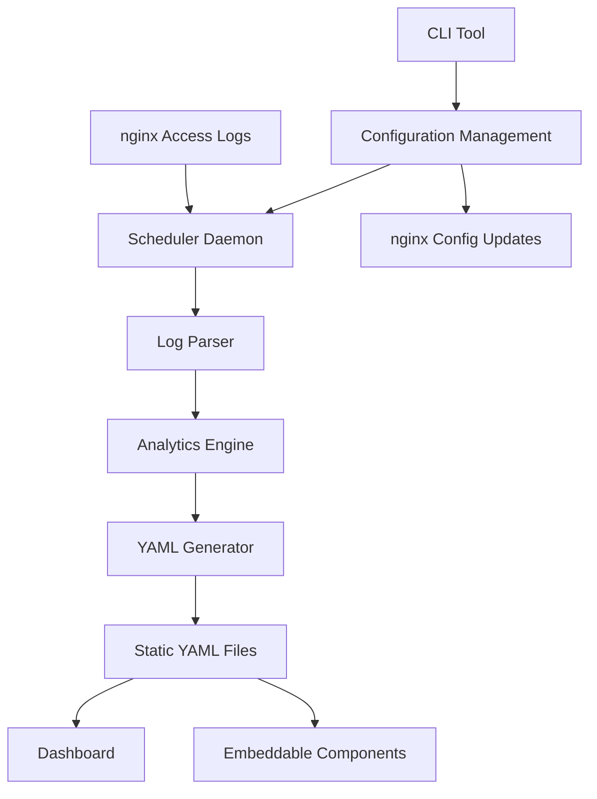

# Design Document: Metrona Analytics System

## Overview

The Metrona Analytics System is a self-hosted, privacy-focused web analytics solution built as a Node.js monorepo. The system processes nginx access logs to generate static YAML datasets and provides both centralized dashboards and embeddable components for individual projects. The architecture emphasizes modularity, performance, and privacy compliance while maintaining framework-agnostic compatibility.

The system operates on a log-parsing paradigm where nginx access logs are processed by a scheduled daemon to generate structured analytics data. This approach eliminates the need for client-side tracking scripts and ensures complete data ownership.

## Architecture

### System Components

The system follows a microservices-inspired monorepo architecture with five core packages:

1. **CLI Package** (`@metrona/cli`): Interactive setup wizard and management tools
2. **Parser Package** (`@metrona/parser`): Core log processing and analytics generation
3. **Scheduler Package** (`@metrona/scheduler`): Daemon service for automated processing
4. **Dashboard Package** (`@metrona/dashboard`): Central monitoring interface
5. **Components Package** (`@metrona/components`): Embeddable analytics widgets

### Data Flow Architecture



### Deployment Architecture

The system supports two deployment modes:
- **Standalone Mode**: All components run on a single server with local file storage
- **Distributed Mode**: Components can be deployed across multiple servers with shared storage

## Components and Interfaces

### CLI Package Interface

The CLI package provides an interactive setup wizard and management commands:

```javascript
// Core CLI Commands
class CLICommands {
  async setup() {
    // Interactive setup wizard
    // - Dependency checking (Node.js, nginx)
    // - Storage configuration
    // - Dashboard authentication setup
    // - Initial site configuration
    // - nginx integration
    // - systemd service creation
  }
  
  async addSite(domain, logPath, frequency) {
    // Add new site to configuration
    // - Validate domain and paths
    // - Update nginx configuration
    // - Reload scheduler configuration
  }
  
  async removeSite(domain) {
    // Remove site from monitoring
    // - Clean up configuration
    // - Archive existing data
  }
  
  async status() {
    // Display system status
    // - Scheduler daemon status
    // - Last processing times
    // - Error summaries
  }
}
```

**nginx Configuration Management:**
- Backup existing configurations to timestamped directories
- Inject custom log format definitions
- Add site-specific log directives
- Validate configurations before applying changes
- Provide rollback capabilities on validation failures

### Parser Package Interface

The parser package handles log processing with streaming capabilities for memory efficiency:

```javascript
class NginxLogParser {
  constructor(logPath, lastPosition = 0) {
    this.logPath = logPath;
    this.lastPosition = lastPosition;
    this.logFormat = /^(\S+) - (\S+) \[([^\]]+)\] "([^"]*)" (\d+) (\d+) "([^"]*)" "([^"]*)"/;
  }
  
  async *parseLogStream() {
    // Stream-based log parsing
    // - Read from last known position
    // - Parse line by line using regex
    // - Yield parsed entries incrementally
    // - Handle log rotation files (.1, .gz)
  }
  
  async generateAnalytics() {
    // Process parsed entries into analytics
    // - Calculate pageviews and unique visitors
    // - Group by time periods (hourly, daily, monthly)
    // - Rank pages and referrers
    // - Generate summary statistics
  }
}

class AnalyticsCalculator {
  calculateUniqueVisitors(entries) {
    // Privacy-preserving visitor counting
    // - Hash IP + User-Agent combinations
    // - Use SHA-256 with salt for anonymization
    // - Return approximate unique count
  }
  
  groupByTimePeriod(entries, period) {
    // Time-series data generation
    // - Support hourly, daily, monthly grouping
    // - Handle timezone considerations
    // - Generate complete time series with zero-fill
  }
  
  rankContent(entries, metric) {
    // Content ranking algorithms
    // - Sort by pageviews or unique visitors
    // - Filter out static assets and admin paths
    // - Apply configurable exclusion patterns
  }
}
```

### Scheduler Package Interface

The scheduler manages automated processing with configuration hot-reloading:

```javascript
class AnalyticsScheduler {
  constructor(configPath) {
    this.configPath = configPath;
    this.jobs = new Map();
    this.configWatcher = null;
  }
  
  async start() {
    // Initialize scheduler daemon
    // - Load configuration
    // - Schedule jobs for each site
    // - Start configuration file watcher
    // - Set up graceful shutdown handlers
  }
  
  scheduleJob(site) {
    // Create cron job for site
    // - Parse frequency (daily, hourly, cron expression)
    // - Create job with error handling
    // - Track job execution status
  }
  
  async executeJob(site) {
    // Execute parsing job for site
    // - Initialize parser with site configuration
    // - Process logs and generate analytics
    // - Write YAML output to configured location
    // - Log execution results and errors
  }
  
  reloadConfiguration() {
    // Hot-reload configuration changes
    // - Cancel existing jobs
    // - Reload configuration file
    // - Reschedule jobs with new settings
  }
}
```

### Dashboard Package Interface

The dashboard provides both static and server-based deployment options:

```javascript
// Static Mode (default)
class StaticDashboard {
  async loadSiteData(domain) {
    // Load YAML data via fetch API
    // - Parse YAML to JavaScript objects
    // - Handle loading states and errors
    // - Cache data for performance
  }
  
  renderCharts(data, timeRange) {
    // Render analytics visualizations
    // - Line charts for time-series data
    // - Bar charts for rankings
    // - Summary cards for key metrics
    // - Responsive design for mobile
  }
}

// Server Mode (with authentication)
class DashboardServer {
  setupAuthentication() {
    // Session-based password authentication
    // - bcrypt password verification
    // - Rate limiting for login attempts
    // - Session management
  }
  
  setupAPIEndpoints() {
    // Protected API endpoints
    // - GET /api/sites - list all configured sites
    // - GET /api/data/:domain - get site analytics data
    // - GET /api/export/:domain - export data as CSV
  }
}
```

### Components Package Interface

Framework-agnostic Web Components for embedding analytics:

```javascript
class AnalyticsSummary extends HTMLElement {
  static get observedAttributes() {
    return ['data-url', 'time-range'];
  }
  
  async connectedCallback() {
    // Component initialization
    // - Load data from configured URL
    // - Set up intersection observer for lazy loading
    // - Render initial state
  }
  
  async loadData() {
    // Data loading with error handling
    // - Fetch YAML data
    // - Parse and validate structure
    // - Handle network errors gracefully
  }
  
  render(data) {
    // Render analytics summary
    // - Display key metrics (pageviews, visitors)
    // - Apply CSS custom properties for theming
    // - Emit custom events for interactions
  }
}

class AnalyticsChart extends HTMLElement {
  // Chart component for time-series visualization
  // - Support line and bar chart types
  // - Configurable metrics and time ranges
  // - Responsive SVG-based rendering
}

class AnalyticsTable extends HTMLElement {
  // Table component for rankings
  // - Top pages, referrers, or custom metrics
  // - Sortable columns
  // - Pagination for large datasets
}
```

## Data Models

### Configuration Data Model

```yaml
# /etc/analytics/config.yaml
version: 1
storage:
  data_path: /var/analytics/data
  backup_enabled: true
  retention_days: 365

dashboard:
  enabled: true
  port: 3001
  password_hash: $2b$12$...
  rate_limit: 10  # requests per minute

sites:
  - domain: example.com
    nginx_config: /etc/nginx/sites-available/example.com
    log_path: /var/log/nginx/example.com-analytics.log
    frequency: daily
    enabled: true
    exclusions:
      - /admin/*
      - /api/health
      - *.css
      - *.js
      - *.png
```

### Analytics Data Model

```yaml
# /var/analytics/data/{domain}/data.yaml
generated_at: "2026-01-04T12:00:00Z"
site: example.com
version: 1

summary:
  total_pageviews: 15420
  unique_visitors: 3201
  top_page: /blog/post-123
  top_referrer: google.com
  bounce_rate: 0.65
  avg_session_duration: 180

timeframes:
  day_1:
    start: "2026-01-03T00:00:00Z"
    end: "2026-01-04T00:00:00Z"
    pageviews: 450
    unique_visitors: 120
    hourly:
      - hour: 0
        pageviews: 12
        unique_visitors: 8
      # ... all 24 hours
    
  day_7:
    start: "2025-12-28T00:00:00Z"
    end: "2026-01-04T00:00:00Z"
    pageviews: 3200
    unique_visitors: 890
    daily:
      - date: "2025-12-28"
        pageviews: 420
        unique_visitors: 180
      # ... all 7 days

top_pages:
  - path: /blog/post-123
    pageviews: 1420
    unique_visitors: 890
    bounce_rate: 0.45
  # ... top 20

top_referrers:
  - domain: google.com
    pageviews: 4500
    unique_visitors: 2100
    paths:
      - path: /search?q=analytics
        pageviews: 2300
      # ... top referrer paths
  # ... top 20

sections:
  - name: blog
    pattern: /blog/*
    pageviews: 8500
    unique_visitors: 3200
  - name: docs
    pattern: /docs/*
    pageviews: 2300
    unique_visitors: 1100
```

### Log Entry Data Model

```javascript
// Parsed log entry structure
class LogEntry {
  constructor(rawLine) {
    this.timestamp = null;      // Date object
    this.ip = null;            // String (hashed for privacy)
    this.method = null;        // HTTP method
    this.path = null;          // Request path
    this.status = null;        // HTTP status code
    this.bytes = null;         // Response size
    this.referrer = null;      // Referrer URL
    this.userAgent = null;     // User agent string (hashed)
    this.responseTime = null;  // Response time in seconds
  }
  
  isPageview() {
    // Determine if entry represents a pageview
    // - Status codes 200-399
    // - Exclude static assets
    // - Exclude API endpoints
  }
  
  getVisitorHash() {
    // Generate privacy-preserving visitor identifier
    // - Combine IP and User-Agent
    // - Apply SHA-256 hashing with salt
  }
  
  getReferrerDomain() {
    // Extract domain from referrer URL
    // - Parse URL and extract hostname
    // - Handle direct traffic (no referrer)
    // - Exclude own domain
  }
}
```

## Correctness Properties

*A property is a characteristic or behavior that should hold true across all valid executions of a system—essentially, a formal statement about what the system should do. Properties serve as the bridge between human-readable specifications and machine-verifiable correctness guarantees.*

### Property 1: Log Entry Parsing Completeness
*For any* valid nginx access log entry, the parser should extract all required fields (timestamp, IP, method, path, status, bytes, referrer, user-agent) without data loss or corruption.
**Validates: Requirements 1.1**

### Property 2: Visitor Hash Consistency
*For any* combination of IP address and user agent, the hashing function should produce identical hashes for identical inputs and different hashes for different inputs, ensuring privacy-preserving visitor identification.
**Validates: Requirements 1.2**

### Property 3: Time-Series Grouping Accuracy
*For any* collection of log entries with timestamps, grouping by time periods (hourly, daily, monthly) should place each entry in exactly one correct time bucket based on its timestamp.
**Validates: Requirements 1.3**

### Property 4: Content Ranking Correctness
*For any* set of pages with different traffic volumes, the ranking algorithm should order pages with higher pageview counts before those with lower counts.
**Validates: Requirements 1.4**

### Property 5: Memory-Bounded Processing
*For any* log file size, the parser should maintain memory usage below a fixed threshold regardless of input file size, demonstrating streaming behavior.
**Validates: Requirements 1.5**

### Property 6: Log File Discovery Completeness
*For any* directory containing log files with various extensions (.log, .1, .gz), the parser should discover and include all files matching the expected patterns.
**Validates: Requirements 1.6**

### Property 7: Job Scheduling Consistency
*For any* configuration containing N enabled sites, the scheduler should create exactly N parsing jobs upon initialization.
**Validates: Requirements 2.1**

### Property 8: Configuration Hot-Reload Correctness
*For any* configuration change, the scheduler should update its job schedule to reflect the new configuration without requiring a restart.
**Validates: Requirements 2.3**

### Property 9: Comprehensive Input Validation
*For any* user input (domain names, file paths, cron expressions, configuration values), the system should accept valid inputs and reject invalid inputs with specific error messages.
**Validates: Requirements 3.1, 3.2, 3.5, 8.4**

### Property 10: YAML Output Structure Consistency
*For any* analytics data generated, the output YAML files should conform to the defined schema with all required fields (generation timestamp, site identification, summary statistics, time-series data).
**Validates: Requirements 2.4, 7.1, 7.6**

### Property 11: Configuration Serialization Round-Trip
*For any* valid configuration object, serializing to YAML and deserializing back should produce an equivalent configuration object.
**Validates: Requirements 3.3**

### Property 12: Backup Creation Reliability
*For any* nginx configuration modification, backup files should be created in the designated location before any changes are applied.
**Validates: Requirements 3.4**

### Property 13: Site Processing Conditional Logic
*For any* collection of sites with mixed enabled/disabled flags, only sites marked as enabled should be processed during analytics generation.
**Validates: Requirements 3.6**

### Property 14: nginx Configuration Generation Correctness
*For any* set of setup parameters, the CLI tool should generate nginx configuration snippets that include the required log format and access log directives.
**Validates: Requirements 4.2**

### Property 15: Comprehensive Authentication Security
*For any* password input, the system should generate bcrypt hashes with appropriate cost factors, and authentication should be required for protected resources with HTTPS enforcement in production.
**Validates: Requirements 4.3, 8.2, 5.4, 8.5**

### Property 16: Service File Generation Correctness
*For any* systemd service generation request, the created service files should contain the required configuration sections and have restrictive file permissions.
**Validates: Requirements 4.5**

### Property 17: Error Recovery and Rollback
*For any* configuration error or validation failure, rollback functionality should be available and should restore the previous valid state.
**Validates: Requirements 4.6**

### Property 18: Comprehensive UI Rendering
*For any* analytics data, the dashboard and components should render all required information (site overviews, pageviews, top pages, referrer information) in the expected HTML structure.
**Validates: Requirements 5.1, 5.2, 6.3**

### Property 19: Date Range Filtering Accuracy
*For any* analytics dataset and date range selection, the filtered results should include only data points within the specified time period.
**Validates: Requirements 5.3**

### Property 20: Data Export Format Correctness
*For any* analytics data export request, the generated CSV should contain all expected data fields in the correct format.
**Validates: Requirements 5.6**

### Property 21: Framework Compatibility
*For any* supported framework (Next.js, Astro, Express, vanilla HTML), the analytics components should render correctly and function as expected.
**Validates: Requirements 6.1**

### Property 22: Component Data Loading
*For any* configurable data URL, components should successfully fetch and parse YAML datasets, handling network errors gracefully.
**Validates: Requirements 6.2**

### Property 23: CSS Theming Support
*For any* CSS custom property values applied to components, the visual appearance should reflect the theme changes appropriately.
**Validates: Requirements 6.4**

### Property 24: Custom Event Emission
*For any* data update or user interaction in components, the appropriate custom events should be emitted with correct event data.
**Validates: Requirements 6.6**

### Property 25: Time-Series Data Organization
*For any* collection of log entries, the generated time-series data should be correctly organized into hourly, daily, and aggregate views with proper time bucket alignment.
**Validates: Requirements 7.2**

### Property 26: Top Content Data Completeness
*For any* top content list generation, each entry should include all required fields (page path, pageview count, unique visitor estimate).
**Validates: Requirements 7.3**

### Property 27: Referrer Data Grouping
*For any* collection of referrer data, entries should be correctly grouped by domain with specific referrer paths included under each domain.
**Validates: Requirements 7.4**

### Property 28: Summary Statistics Accuracy
*For any* raw analytics data, calculated summary statistics (total pageviews, unique visitors, top content) should accurately reflect the underlying data.
**Validates: Requirements 7.5**

### Property 29: Comprehensive Privacy Protection
*For any* processed visitor data, raw IP addresses and user agents should never appear in output files, and no persistent cookies or third-party tracking should be used.
**Validates: Requirements 8.1, 8.6**

### Property 30: File Security Permissions
*For any* sensitive configuration file created by the system, the file permissions should be set to 0600 (owner read/write only).
**Validates: Requirements 8.3**

### Property 31: Streaming Memory Efficiency
*For any* log file processing operation, memory usage should remain bounded and not increase proportionally with input file size.
**Validates: Requirements 9.5**

### Property 32: Incremental Update Behavior
*For any* existing analytics data and new log entries, the update process should modify only the affected data points rather than recalculating everything.
**Validates: Requirements 9.6**

### Property 33: Error Isolation and Logging
*For any* processing error (missing files, generation failures), appropriate error logs should be created and the error should not prevent processing of other sites or jobs.
**Validates: Requirements 10.1, 10.2, 10.4**

### Property 34: nginx Configuration Validation
*For any* nginx configuration change, validation should occur before applying changes, and invalid configurations should be rejected with rollback options available.
**Validates: Requirements 10.3**

### Property 35: Authentication Rate Limiting
*For any* series of failed authentication attempts, rate limiting should be triggered after a threshold number of failures to prevent brute force attacks.
**Validates: Requirements 10.5**

### Property 36: Dependency Detection and Messaging
*For any* missing system dependency, the CLI tool should detect the absence and provide clear installation instructions.
**Validates: Requirements 10.6**

## Error Handling

### Error Categories

**1. Input Validation Errors**
- Invalid domain names or file paths
- Malformed cron expressions
- Corrupted configuration files
- Response: Reject input with specific error messages, prevent system state changes

**2. File System Errors**
- Missing or inaccessible log files
- Permission denied on configuration directories
- Disk space exhaustion
- Response: Log errors, continue with other operations where possible, provide recovery suggestions

**3. Processing Errors**
- Malformed log entries
- YAML generation failures
- Memory exhaustion during large file processing
- Response: Skip problematic entries, preserve existing data, log detailed error information

**4. Network and Service Errors**
- Dashboard authentication failures
- Component data loading failures
- nginx configuration validation failures
- Response: Implement retry logic, fallback to cached data, provide user feedback

### Error Recovery Strategies

**Graceful Degradation:**
- Continue processing other sites when one site fails
- Preserve existing data when updates fail
- Provide partial functionality when components fail to load

**Rollback Mechanisms:**
- Backup configurations before modifications
- Restore previous state on validation failures
- Maintain data integrity during interrupted operations

**Monitoring and Alerting:**
- Structured error logging with severity levels
- Error rate tracking and threshold alerting
- Health check endpoints for system monitoring

## Testing Strategy

### Dual Testing Approach

The system will employ both unit testing and property-based testing as complementary approaches:

**Unit Tests:**
- Verify specific examples and edge cases
- Test integration points between components
- Validate error conditions and recovery mechanisms
- Focus on concrete scenarios and known failure modes

**Property-Based Tests:**
- Verify universal properties across all inputs
- Test system behavior with randomized data
- Ensure correctness properties hold under various conditions
- Provide comprehensive input coverage through generation

### Property-Based Testing Configuration

**Testing Framework:** fast-check (JavaScript property-based testing library)
**Test Configuration:**
- Minimum 100 iterations per property test
- Each property test references its design document property
- Tag format: **Feature: metrona-analytics-system, Property {number}: {property_text}**

**Test Generators:**
- Log entry generators with realistic nginx log formats
- Configuration generators with valid and invalid combinations
- Time-series data generators with various temporal patterns
- File system state generators for testing file operations

### Testing Coverage Requirements

**Core Functionality Testing:**
- Log parsing accuracy and completeness
- Analytics calculation correctness
- Configuration management reliability
- Scheduler job execution and error handling

**Integration Testing:**
- End-to-end log processing pipeline
- Dashboard data loading and rendering
- Component framework compatibility
- CLI tool system integration

**Security Testing:**
- Input validation and sanitization
- Authentication and authorization
- Privacy protection mechanisms
- File permission and access controls

**Performance Testing:**
- Memory usage bounds during streaming
- Processing time benchmarks
- Concurrent job execution
- Large dataset handling

Each correctness property must be implemented by a single property-based test that validates the universal behavior described in the property statement.