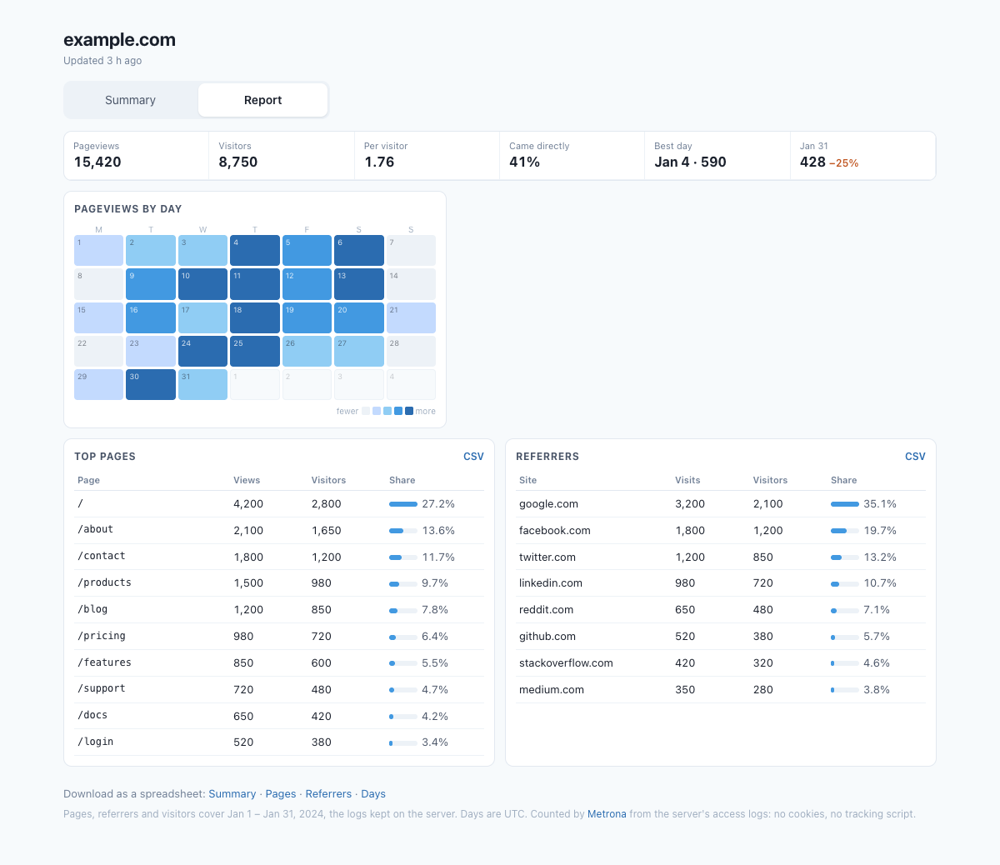
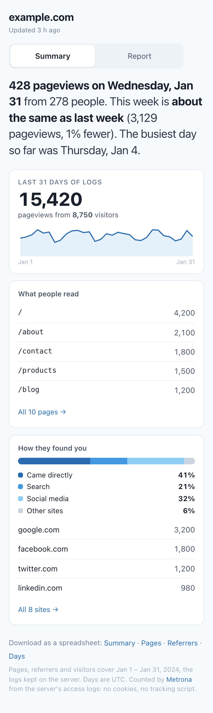

# Metrona user guide

This guide is for the people who run websites: owners, editors, marketers. It explains what you
see in Metrona and what the numbers mean. You don't need to know anything about servers. Someone
has already set Metrona up for you, and you just open it in your browser.

- [Opening the dashboard](#opening-the-dashboard)
- [The all-sites page](#the-all-sites-page)
- [One site in detail](#one-site-in-detail)
- [What the numbers mean](#what-the-numbers-mean)
- [Getting the data out](#getting-the-data-out)
- [Privacy: what Metrona knows and doesn't](#privacy-what-metrona-knows-and-doesnt)
- [Why my numbers differ from Google Analytics](#why-my-numbers-differ-from-google-analytics)
- [Common questions](#common-questions)

## Opening the dashboard

Your administrator gives you an address and a password. Often it's your own site with `/stats/` at
the end, like `example.com/stats/`; sometimes a separate address like `metrona.example.com`. Open it
in any browser, on a computer or a phone. Bookmark it; there's nothing to install.

The numbers update **once an hour**. If you just published something, give it an hour before you
look for its first visitors.

## The all-sites page

The first page sums up every site Metrona counts for you:

- **Total sites** — how many sites are set up, and how many of them are active.
- **Total pageviews** and **Unique visitors** — all sites combined.
- **A card for each site** with its pageviews, visitors and most-viewed page (🔥), and when its
  numbers were last updated.

Click a site's card to open its own page.

## One site in detail

A site's page has two tabs: **Summary** for the quick look, and **Report** for the figures.

### Summary

**The opening sentence** says what happened: the pageviews and people on the latest day, how this
week compares with the week before, and the busiest day so far. A new site gets the comparison after
two weeks of counting; until then, the sentence says when it starts.

**The first card** has the totals for the logs kept on the server (often the last 30 days): how many
pages were opened and by how many people, with a small line of the days in between.

**What people read** lists the most-viewed pages: `/` is the home page, `/blog` your blog's
main page, and so on. **All pages** shows the rest.

**How they found you** splits visits four ways: people who **came directly** (bookmarks, typed
addresses, apps, most email), from **search** engines (and AI assistants), from **social media**,
and from **other sites** that link to you. Below it are the sites that sent the most visits.

### Report

**The row of numbers** at the top: pageviews, visitors, pages per visitor, the share who came
directly, the best day, and the latest day with its change from the day before.

**Pageviews by day** is a calendar of the last five weeks: the darker the square, the busier the
day. It shows the weekly rhythm at a glance (quiet weekends, a busy Thursday) and any spike.

**Top pages** and **Referrers** are full tables:

- *Views* or *Visits*: how many times a page was opened, or how many arrivals a site sent.
- *Visitors*: how many different people that was.
- *Share*: the part of all pageviews (pages) or of all visits from other sites (referrers).

Pages, referrers and visitors cover the logs kept on the server; the footer says which dates. The
day-by-day numbers go further back, because Metrona keeps each day's totals after the old logs are
deleted.

### On a phone

Everything works on a phone; the cards and tables stack.

## What the numbers mean

**Pageview.** One page opened in a browser. If someone reads three articles, that's three
pageviews. Images, styles and other files a page loads behind the scenes aren't counted, only the
page itself.

**Unique visitor.** A different person, as far as Metrona can tell. Metrona treats the same device and
browser on the same internet connection as the same visitor. So a person who visits from their phone
and later from their laptop counts as two. Several people in one office behind one connection, using
identical browsers, may count as one. Like every analytics tool, it's a good estimate, not a
head count.

**Referrer.** The site a visitor came from when they followed a link. Visits from bookmarks, typed
addresses, apps and many email programs carry no referrer. They count as *direct* traffic, so
they appear in your totals but not in the referrers list. Links between your own pages aren't
referrals either.

**Who isn't counted:**

- Search-engine crawlers and other bots, monitoring services and scripts.
- Pages that didn't load: errors and "page not found".
- Background requests your site's code makes while someone is already on a page.

So Metrona's numbers are about **people reading your site**.

**Days follow UTC** (Greenwich time). A "day" in the chart runs from midnight to midnight UTC,
which might be the afternoon or evening where you are.

## Getting the data out

The links at the bottom of a site's page download spreadsheet files (CSV) that open in Excel,
Numbers or Google Sheets:

- **Summary**: the totals and the dates they cover.
- **Pages**: every page in the list, with pageviews and visitors.
- **Referrers**: every site that sent visits, with the kind of site (search, social, other).
- **Days**: pageviews and visitors for each day.

The **CSV** links on the Report tab's tables download those tables.

## Privacy: what Metrona knows and doesn't

Metrona adds **no tracking code and no cookies** to your website, and shares nothing with
any other company. It counts from the access log your web server keeps anyway: one line for each
page someone opens.

To tell visitors apart without knowing who they are, Metrona turns each visitor's address and
browser into a scrambled code that can't be turned back. It counts those codes. Nobody can work
back from a code to a person, and Metrona never shows or stores anyone's IP address.

You don't get a cookie banner from Metrona, because it sets no cookies. Ask whoever handles your
legal pages whether your privacy policy should mention server logs.

## Why my numbers differ from Google Analytics

If you also run a tool like Google Analytics, expect different numbers. Neither tool is broken:

- **Ad blockers and privacy settings** stop script-based tools from counting a share of
  visitors, often 10–40% depending on your audience. Metrona counts from the server, so it still
  sees them. Metrona's numbers are usually **higher**.
- **People who leave fast.** A visitor who leaves before a tracking script loads isn't counted by
  script-based tools. Metrona counts the page as soon as it's delivered.
- **Bots** are filtered differently by every tool.
- **"Visitor" is defined differently** by each tool, and Metrona sets no cookies.

Compare trends, not exact figures: up or down, which pages, which referrers.

## Common questions

**My new page doesn't show up.** Numbers update once an hour, and a page shows up after its first
visit. Wait an hour, then look again; on the Summary tab, use **All pages** to see past the top five.

**Today's numbers look low.** Today isn't over yet, and in UTC it may have started only a few hours
ago.

**I see a page address I don't recognize.** Every address that returned a page is counted, including
old addresses that still work, search pages and pages with odd links. If one looks suspicious, ask
your administrator.

**A site's card says it was updated a long time ago.** Metrona normally updates every hour. If a
site hasn't updated in several hours, tell your administrator; something on the server needs a look.

**Can I see where my visitors are from, or which device they use?** Not yet. Metrona currently
reports pages, referrers and visits over time.

**Who else can see my numbers?** Only people with the dashboard's address and password. Your
administrator controls who has those.
