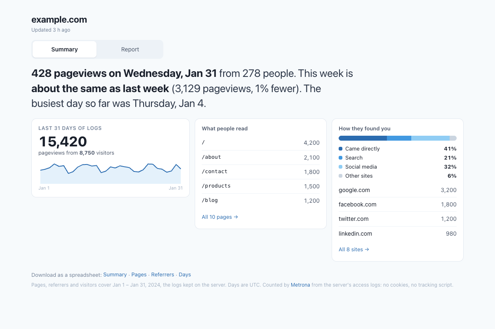
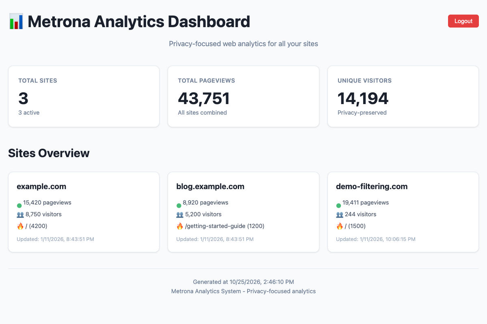

# Metrona

[](https://github.com/teamzork/metrona/actions/workflows/ci.yml)
[](https://github.com/teamzork/metrona/pkgs/container/metrona)
[](LICENSE)

**Website analytics from the logs your server already keeps.** Metrona reads your web server's
access logs and shows each site's pageviews, visitors, top pages, referrers, and daily trends. It
adds no tracking script and no cookies to your pages, and it uses no third-party service.



## Why Metrona

- **Nothing on your pages.** Every request already reaches your server and gets logged; Metrona
  counts from that. Pages stay as fast as they were, and ad blockers don't hide your visitors.
- **Private by design.** Visitors are counted with a salted one-way hash of IP address and
  browser. Raw IPs never leave your server's own log files, and nothing is sent anywhere.
- **People, not bots.** Crawlers, uptime checks, scripts, assets (images, CSS, JavaScript), errors
  and single-page-app background requests are left out.
- **Many sites, one place.** One install counts any number of sites and shows them side by side.
- **Plain files.** Results are YAML files you can read, back up, export to CSV, or feed into
  something else.
- **Small.** A Node.js process that wakes up once an hour. No database.
- **Ask an agent.** A read-only MCP server lets Claude Code, Cursor or any MCP client answer
  "what were the top pages this month?" straight from the numbers.

## What you get

| All sites at a glance | One site in depth |
| --- | --- |
|  |  |
| Pageviews, visitors and the top page of each site | Two tabs: a summary in plain words, and a report with a calendar and tables; CSV downloads |

Running a site and want to know how to read these numbers? See the
**[user guide](Docs/user-guide.md)**. It's written for site owners, not server admins.

## How it works

```
web server access log ──► scheduler (hourly) ──► <site>.yaml ──► dashboard
  nginx or Caddy            parse, filter,         totals, pages,    a small web app
                            hash, count            referrers, days   behind your login
```

1. Your web server writes an access log for each site: nginx in its usual *combined* format, or
   Caddy as JSON.
2. Once an hour the **scheduler** re-reads the logs still on disk and recounts. Re-running is
   always safe. Day-by-day totals are kept even after the old log files are rotated away.
3. The **dashboard** shows the results. It listens only on the server itself. Your web server
   puts it on a hostname of your choice, behind HTTPS and a password.

## Try it in a minute

The dashboard on sample data, with Docker:

```bash
docker run --rm -p 3003:3003 ghcr.io/teamzork/metrona demo     # → http://localhost:3003
```

Or with Node.js 22 or newer:

```bash
git clone https://github.com/teamzork/metrona.git && cd metrona && npm install
npx metrona demo                                                # → http://localhost:3003
```

## Install it on a server

One command sets it up: it asks for nginx or Caddy and each site's access log, then writes the
config, the secrets and the two systemd services, with the right permissions to read the logs.

```bash
sudo npx metrona init --start     # from a clone in /opt/metrona
npx metrona status                # each site, its log, and when its numbers were last written
```

No admin area on your site? `init --stats` puts the numbers at `example.com/stats/` behind a
password, served by your own web server: no extra service, port or hostname.

Prefer containers? [compose.example.yaml](compose.example.yaml) runs the scheduler and the
dashboard with the logs mounted read-only. [**Docs/setup.md**](Docs/setup.md) covers both, plus
putting the dashboard behind HTTPS. For Caddy specifics and how counting works in detail, see
[Docs/caddy.md](Docs/caddy.md).

## Ask an agent

```bash
claude mcp add metrona -- ssh myserver "cd /opt/metrona && npx --no-install metrona mcp"
```

Then ask Claude Code, Cursor or any MCP client about your traffic. The server is read-only, runs
over stdio, and needs no open port: SSH is the login. See [Docs/mcp.md](Docs/mcp.md).

## Commands

| | |
| --- | --- |
| `metrona demo` | The dashboard on sample data |
| `metrona init` | Set it up on this server: config, secrets, systemd units, user, folders; `--stats` adds a password-protected page at `/stats/` on each site |
| `metrona add-site` | Add a site to an installed Metrona, keeping the others (and its `/stats/` page, if the others have one) |
| `metrona status` | Each site's log and when its numbers were last written |
| `metrona run` | Process every site once, now (the scheduler does this hourly) |
| `metrona publish` | Write each site's `/stats/` page as static files, now |
| `metrona scheduler` · `metrona dashboard` | The two services, as systemd and Docker start them |
| `metrona mcp` | The read-only MCP server over stdio |

## Documentation

| | For |
| --- | --- |
| [User guide](Docs/user-guide.md) | Site owners: reading the dashboard, what the numbers mean |
| [Setup](Docs/setup.md) | Admins: installing and running Metrona on a server, or in Docker |
| [MCP](Docs/mcp.md) | Asking an agent about your traffic |
| [Caddy and counting rules](Docs/caddy.md) | Admins: Caddy logs, per-site options, privacy notes |
| [Architecture](Docs/architecture.md) · [API](Docs/api.md) | Developers |
| [Design history](Docs/design/) | The original spec, requirements and task list |

## Repository layout

```
packages/
  cli/         the metrona command (npm: metrona), with the demo data
  parser/      log parsing, filtering, counting, YAML output
  scheduler/   the hourly job and its config
  dashboard/   the web dashboard and a static-HTML mode
  mcp/         the read-only MCP server
  components/  embeddable web components (early, not published)
  shared/      constants and helpers
templates/     config, systemd, nginx and Caddy examples
Docs/          guides
Dockerfile, compose.example.yaml
```

## Development

```bash
npm install
npm test          # every package's Jest suite
```

Plain JavaScript (CommonJS; the MCP server is ESM), so there's no build step. Each package has its
tests next to the source (`*.test.js`, plus `*.property.test.js` for property-based tests). CI runs
them on Node 22 and 24.

Releases: `npm version <minor|patch> --workspaces --no-git-tag-version`, commit, tag `v<version>`,
push the tag. The tag publishes the npm packages ([publish.yml](.github/workflows/publish.yml)) and
the Docker image ([docker.yml](.github/workflows/docker.yml)).

## License

[MIT](LICENSE)
